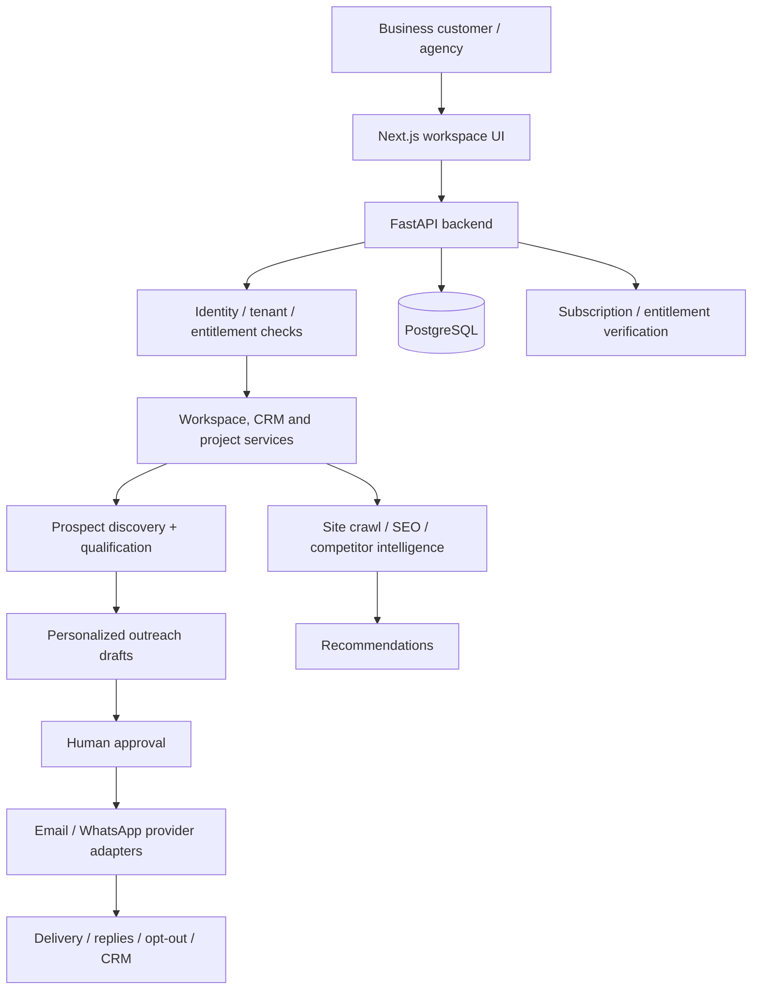

# Outreach Marketing Agent — Project Context

> Source-based product map, reviewed 2026-11-13. Product is being actively evolved; progress scorecards are estimates, not test results.

## Purpose
Multi-tenant SaaS for business-aware prospect discovery, personalized email/WhatsApp outreach, competitor intelligence and SEO/crawlability improvement, with CRM, approvals and subscription access.

## Stack and dependencies
- Backend: FastAPI / Python; dependencies in `backend/requirements.txt`.
- Frontend: Next.js 15, React 19, TypeScript; `frontend/package.json`.
- Persistence: PostgreSQL / asyncpg.
- External provider integrations: LLM, search, email, official WhatsApp Business Platform and billing.
- Deployment architecture includes Vercel frontend and backend/worker deployment paths; confirm current environment configuration before release.

## Architecture

## Flow
1. Business configures workspace, offer, market and ideal customer profile.
2. Discovery gathers public-source evidence and qualifies prospects.
3. SEO/competitor workflows collect evidence and recommendations.
4. Agent drafts personalized outreach; human reviews before sending.
5. Approved messages go through provider adapters; replies and opt-outs update CRM.
6. Verified subscription entitlements govern paid capabilities.

## Feature inventory
- Multi-tenant workspaces and CRM.
- Prospect discovery and qualification.
- Campaign and outreach drafting/approval.
- Email workflow foundations and WhatsApp Business integration foundations.
- Website crawlability/SEO and competitor intelligence.
- PostgreSQL persistence and durable-worker architecture.
- Billing/subscription foundations.
- Hostinger-compatible frontend packaging and Vercel backend deployment paths.

## Roadmap
1. Complete and document production acceptance for email, Meta/WhatsApp and billing provider flows.
2. Run tenant-isolation and authorization tests across API, background jobs, exports and CRM.
3. Verify payment webhooks and server-side entitlement transitions.
4. Add delivery retries, idempotency, suppression/opt-out enforcement and provider rate limits.
5. Document migrations, backup/restore, worker deployment and operational alerts.
6. Improve evidence provenance for prospect/competitor claims and enforce human approval defaults.

## Gaps and verification register
- Production acceptance of live SMTP, Meta/WhatsApp and billing provider flows must be confirmed in target accounts.
- Verify database migrations and tenant isolation before broad multi-tenant release.
- Confirm frontend/backend deployment and environment variable parity.
- Historical readiness scorecards are not test verdicts; run current CI and live integration checks.
- Keep research evidence, inferred fit scores and generated suggestions clearly distinguished.
